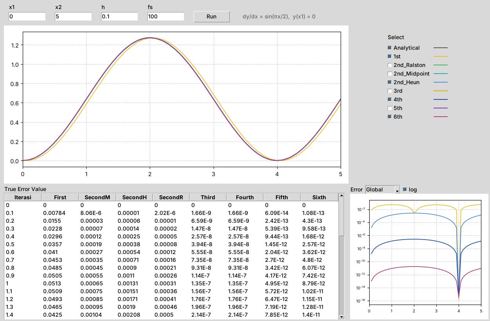

# Runge Kutta

Reproduksi aplikasi perbandingan metode Runge-Kutta (foto kelas, 10-Sep-2026):
solusi analitik vs. Euler, RK orde 2 (Ralston, Midpoint, Heun), RK3, RK4, RK5, RK6,
beserta tabel *true error* dan grafik error.




## Menjalankan

```bash
pip install numpy matplotlib
python app.py           # GUI (tkinter, sudah bawaan Python di Windows)
python rk_methods.py    # cetak tabel true error di terminal
```

## Tampilan

| Bagian | Fungsi |
|---|---|
| `x1`, `x2` | Interval integrasi |
| `h` | Step size |
| `fs` | Jumlah titik per satuan x untuk kurva analitik (resolusi plot) |
| **Run** | Hitung ulang semua metode |
| **Select** | Pilih kurva yang ditampilkan di grafik utama dan grafik error |
| **True Error Value** | `|y_analitik − y_numerik|` di tiap iterasi |
| **Error: Global / Local** | Global = error terakumulasi; Local = error satu langkah dari nilai eksak |
| **log** | Grafik error skala logaritmik (error RK5/RK6 ≈ 1e-12 tidak terlihat di skala linear) |

## ODE

```text
dy/dx = sin(πx/2),   y(0) = 0
y(x)  = (2/π)·(1 − cos(πx/2))
```

ODE ini diidentifikasi dari tabel di foto: dengan `h = 0.1`, error Euler, Midpoint, Heun,
Ralston, RK3, RK4 dan RK5 hasil program ini **sama persis** dengan angka di foto
(misal Euler 0.00784, 0.0155, 0.0228, …; RK4 1.66E-9, 6.59E-9, …; RK5 6.09E-14, 2.42E-13, …).
Untuk ODE lain, ubah `f`, `analytical` dan `Y0` di [`rk_methods.py`](rk_methods.py).

## Metode

| Kolom | Metode | Orde global |
|---|---|:-:|
| First | Euler | 1 |
| SecondM | Midpoint | 2 |
| SecondH | Heun (tanpa iterasi) | 2 |
| SecondR | Ralston (`a2 = 2/3`, `k2` di `x + 3h/4`, versi Chapra) | 2 |
| Third | RK3 Kutta | 3 |
| Fourth | RK4 klasik | 4 |
| Fifth | RK5 Butcher (6 tahap) | 5 |
| Sixth | RK6 Butcher (7 tahap) | 6 |

## Catatan analisis

- **Third = Fourth.** Karena `f` hanya bergantung pada `x`, RK3 dan RK4 sama-sama
  tereduksi menjadi aturan Simpson 1/3, jadi errornya identik. Ini bukan bug.
- **Sixth.** Di foto kolom Sixth sama dengan Fifth. Dengan RK6 Butcher yang benar,
  errornya berbeda (1.08E-13 vs 6.09E-14 di x = 0.1), karena titik kuadraturnya
  (0, 1/3, 1/2, 2/3, 1) berbeda dengan RK5 (0, 1/4, 1/2, 3/4, 1).
  Kemungkinan aplikasi asli memanggil fungsi RK5 di kolom Sixth.
- Format angka tabel mengikuti aplikasi asli: 3 angka penting, notasi ilmiah di bawah 1e-5,
  selain itu dipotong (bukan dibulatkan) ke 5 desimal.

## Referensi

1. Chapra, S. C., & Canale, R. P. (2015). *Numerical Methods for Engineers* (7th ed.), McGraw-Hill. Bab 25 (Runge-Kutta: Heun, Midpoint, Ralston, RK3, RK4, RK5 Butcher).
2. Butcher, J. C. (2016). *Numerical Methods for Ordinary Differential Equations* (3rd ed.), Wiley. Metode RK orde 5 dan 6.
3. Burden, R. L., & Faires, J. D. (2011). *Numerical Analysis* (9th ed.), Brooks/Cole. Bab 5 (error lokal dan global).
4. Ralston, A. (1962). Runge-Kutta methods with minimum error bounds. *Mathematics of Computation*, 16(80), 431–437.
